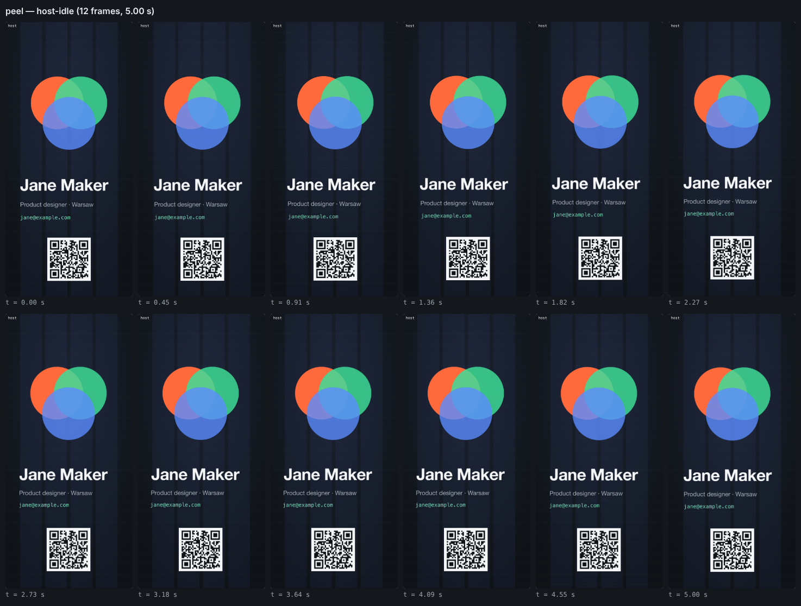
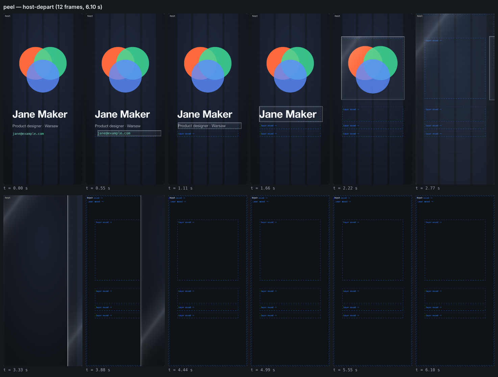
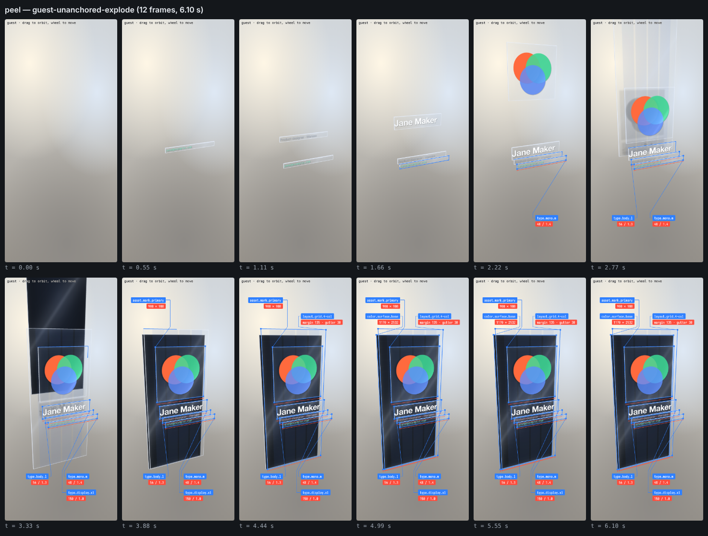
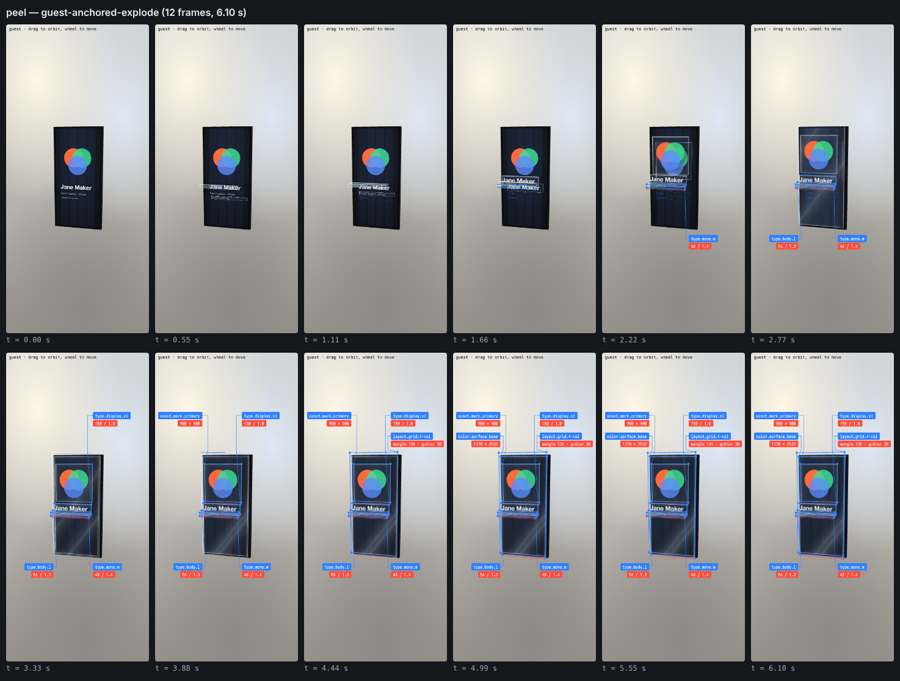
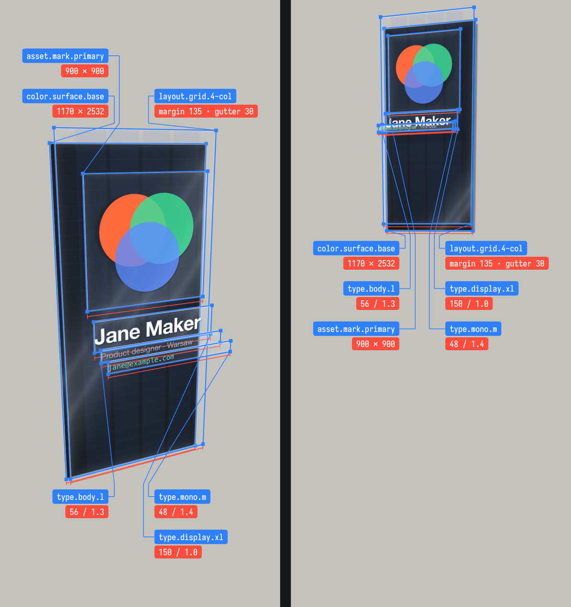
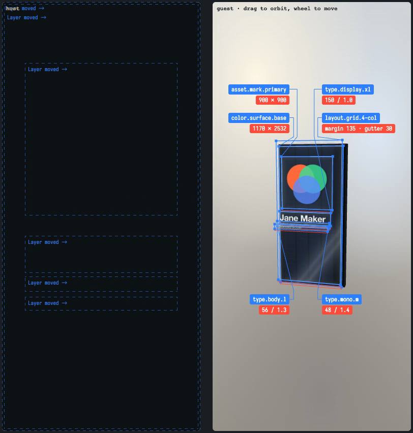

# Process — one captioned image per milestone

## M1 — host idle (`m1-host-idle.png`)

**What it shows.** Twelve frames of host `idle` over one 5 s breath while the tilt input sweeps a
circle. Frame one (t = 0, tilt 0) is the flat card: mean difference to a 2D-canvas composite 0.29/255,
largest single difference 2/255. In the other frames the upper layers slide by up to 10 CSS px and the
QR by at most 4 px, never scaled.

**What it means for the next step.** The pixel rule holds: every layer is rasterised by the 2D canvas
at screen resolution and drawn 1:1, so "flat" is exact by construction. The contact shadows are almost
invisible on this dark card (shadow colour #05070A on #0F1216) — they will carry weight only over the
bright camera image in the guest view, so M3 has to prove them there. The same sheets, state and
schedule now drive `connect`, `depart` and `rebuild`.

## M2 — host connect, depart, rebuild (`m2-host-depart.png`)

**What it shows.** Host `depart`, 6.1 s. Top layer first, every 0.6 s a sheet turns into acrylic
(rim, tint, one specular band), lifts and slides out through the right edge. What stays is a 1 px
dashed outline with the tag "Layer moved →". From 4.1 s on the screen holds only outlines on the card
background colour — the counter of what has left — while the guest inspects the stack.

**What it means for the next step.** The outlines of the two full-bleed layers coincide, so each
further coincident outline is inset by 4 px; otherwise six layers would read as five. The acrylic
look works on a dark card mostly through the rim, so the guest view (M3) should lean on the rim and
the shadows on the bright camera image, not on the tint. `rebuild` returns to idle frame zero with
zero differing pixel values, so the shell can loop host timelines without a seam.

## M3 — guest, unanchored (`m3-guest-unanchored-explode.png`)

**What it shows.** Guest `explode` with pose `null`, over a stand-in room. Sheets enter from the top
edge on the shared schedule and settle into the exploded stack in a fixed pose 30° off the normal.
After each settle the sheet gets its frame, four handles, a red measurement line and a callout: blue
chip with the label, red pill with the dims. Blocks cannot fit beside the stack on a 390 px screen
(two 145 px blocks leave 40 px), so they stand in rows above and below it.

**What it means for the next step.** The first version drew leaders straight from block to corner
and they ran behind other blocks; the rail-and-gate callout fixed that and is the layout the
anchored view inherits. White print on clear acrylic vanished over the bright room until the dark
background sheet arrived (3.2 s); the print now casts a small shadow inside its slab. The dense
spot is the three text strips: their frames and measurement lines overlap near head-on — inherent
to this card and the 0.035 stair, to be judged by Eryk.

## M4 — guest, anchored (`m4-guest-anchored-explode.png`)

**What it shows.** The same timeline anchored to a fake pose (yaw −14°, pitch 9°, 5.6 card widths
away, about 39 cm for a 7 cm wide screen). The stand-in camera shows the host phone running
`depart` at the same time: a layer leaves the host screen in the moment its sheet lifts in the air.

**What it means for the next step.** At a real viewing distance the card is about a third of the
guest screen wide, so the sheets are small and the callouts carry the reading; legibility of the
12 px labels matters more than detail inside the sheets. During the first 0.9 s of each lift the
layer is visible twice (leaving on the host screen, rising in the air) — acceptable in the stand-in,
to be checked on real phones. Checks and numbers come next.

## M5 — chrome polish, tiers, performance (`m5-chrome-and-margins.png`)

**What it shows.** Two guest frames at 2x, end of `explode`. Left: unanchored, the final callout
layout — rows of blocks above and below the stack, each leader running to a rail, dropping to a gate
and turning to its corner; 12 px labels in the bundled font. Right: anchored with the host phone at
the top edge of the camera image (the case Eryk reported at 17:12): no room above, so all six blocks
stand below the stack, inside the 8 % margins.

**What it means for the next step.** Legibility and margins are now properties of the layout, not
of a lucky pose; `chrome` asserts them in twelve views. What stays open is taste: leaders from the
far rows are long, and the three text strips still crowd each other. Performance is not the
constraint on a laptop GPU (0.4 ms per frame); it has to be measured on a phone.

## M6 — checks, artifacts, report (`m6-sequence-frame.png`)

**What it shows.** One frame (t = 7.4 s) of `artifacts/peel-sequence.mp4`, rendered natively on the
Mac's GPU: on the left the host screen at the end of `depart` — six dashed outlines with their
"Layer moved →" tags on the card background; on the right the guest view over the stand-in camera —
the labelled stack hovering above the host phone during the inspection hold.

**What it means next.** Every check passes on the Mac and the shell already runs against the
module. The next evidence has to come from real phones: frame times at `mid`, tracking jitter
against the 1.5 px hairlines, and whether the doubled layer during a lift is visible in practice.
