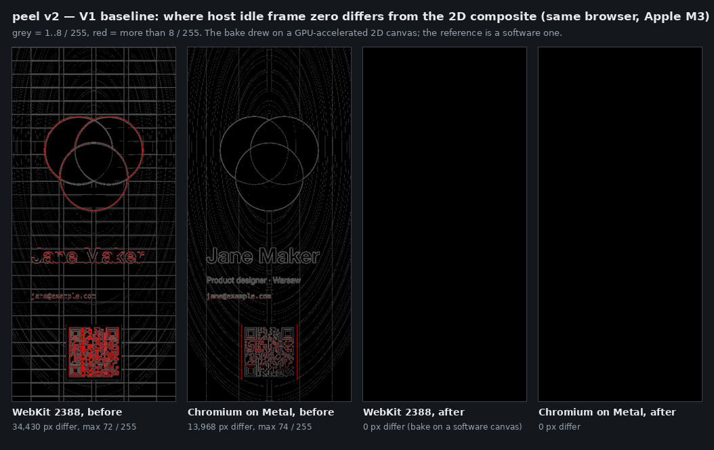
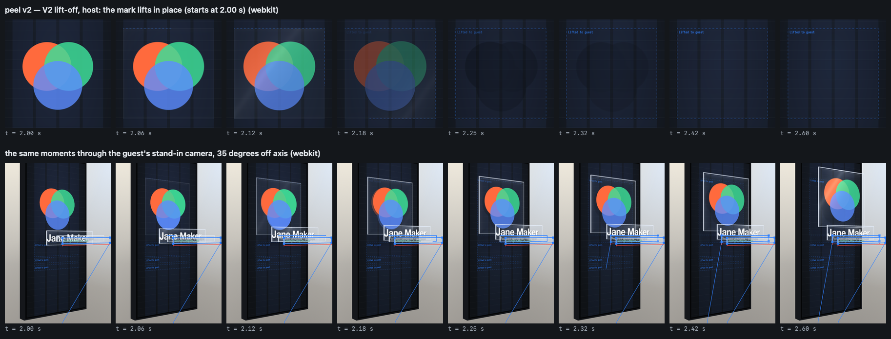
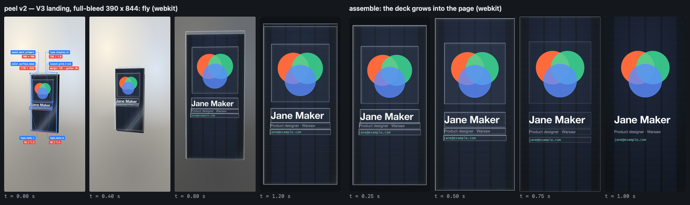
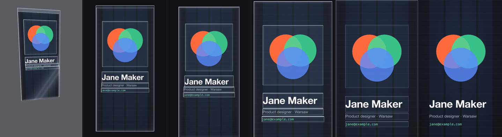
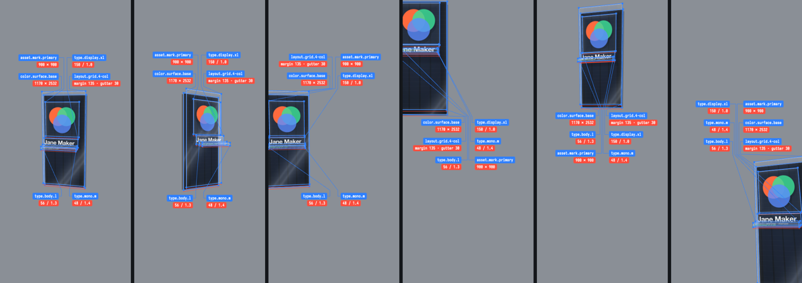
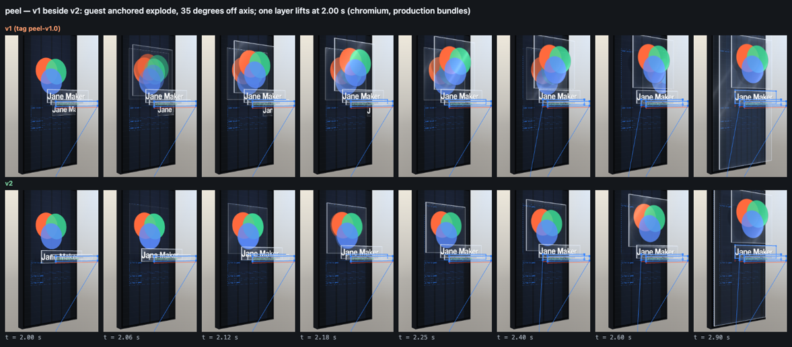

# process — one image per milestone (peel v2)

v1's process images are in `history/v1/process/`.

## V1 — baseline in both browsers

`v1-baseline-diff.png` — where host idle frame zero differs from the 2D composite rendered in the
same browser, on the Mac (Apple M3). Grey is 1–8 / 255, red is more. Before: WebKit 34,430 px, max
72; Chromium on Metal 13,968 px, max 74 — while all 16 v1 checks were green, because they asserted
the mean and ran where there is no GPU. After: 0 px in both. The bake drew layers on a
GPU-accelerated 2D canvas, which scales with a different filter than the software canvas of the
reference; it now draws on a software one.

`v1-baseline-webkit-host-depart.png` — the contact sheet of this milestone: v1's host `depart`,
rendered by WebKit, before any v2 change (layers still slide out through the right edge).

## V2 — the lift-off

`v2-liftoff.png` — one layer (the mark) leaving, top row: the host screen alone; bottom row: the same
moments through the guest's stand-in camera, 35° off axis. On the host the print swells inside its
own rect, a highlight crosses it, it fades while its shadow drifts down-right, and the dashed outline
with "Lifted to guest" is all that is left at 0.25 s. In the guest's view the sheet starts flat on
the glass exactly over the print and rises towards the camera; from 0.25 s on the layer exists only
in the air.

Contact sheets of this milestone: `artifacts/sheet-host-depart.png`, `artifacts/sheet-host-rebuild.png`,
`artifacts/sheet-guest-anchored-frontal-explode.png`, `artifacts/sheet-guest-anchored-offaxis35-explode.png`.

## V3 — the landing is the page

`v3-landing-full-bleed.png` — guest, full-bleed `assembleRect` (390 × 844), WebKit. Left: `fly` —
the stack leaves the air and arrives as a deck that keeps 4 % of the canvas free on every side
(v1's deck was 1.12× the page and would have been cut by both side edges). Right: `assemble` — the
sheets drop flat while the deck grows into the page; the last frame is the page itself.

`v3-landing-overflow.png` — the same landing on a canvas shorter than the card (393 × 659 canvas,
`assembleRect` 393 × 850): the whole deck is visible at the end of `fly`, then it grows to the full
width and its lower part runs below the canvas. Nothing touches the side edges on the way.

## V4 — labels that hold still

`v4-labels.png` — the settled stack in six poses, WebKit: the standard view, 35° off axis, the stack
cut by the left edge, by the top-left corner, by the top edge and by the bottom-right corner. Blocks
sit in rows above and below the stack in two columns, inside the 8 % margins; every leader runs
stub → rail → gate → corner and none crosses another (v1 crossed in the third and fourth view and in
their mirror image). What a still image cannot show is in `checks/results/*/label-steady.json`: under
a 1.5 px / 30 Hz jitter the blocks do not move at all, and a change of slots slides in 0.22 s.

## V5 — v1 beside v2

`v5-v1-beside-v2.png` — the same eight moments of one layer leaving (the mark, from 2.00 s), seen
through the guest's stand-in camera 35° off axis. Top: v1's production bundle, read out of the tag
`peel-v1.0`. Bottom: v2's. Both are driven only through the contract, under a fake clock
(`scripts/compare.mjs`). In v1 the mark is on the host's screen and in the air at once, and the
previous layer is still sliding out to the right; in v2 every layer is in one place. Full size, with
the frontal view and the host alone: `artifacts/compare-v1-v2-*.png`.
