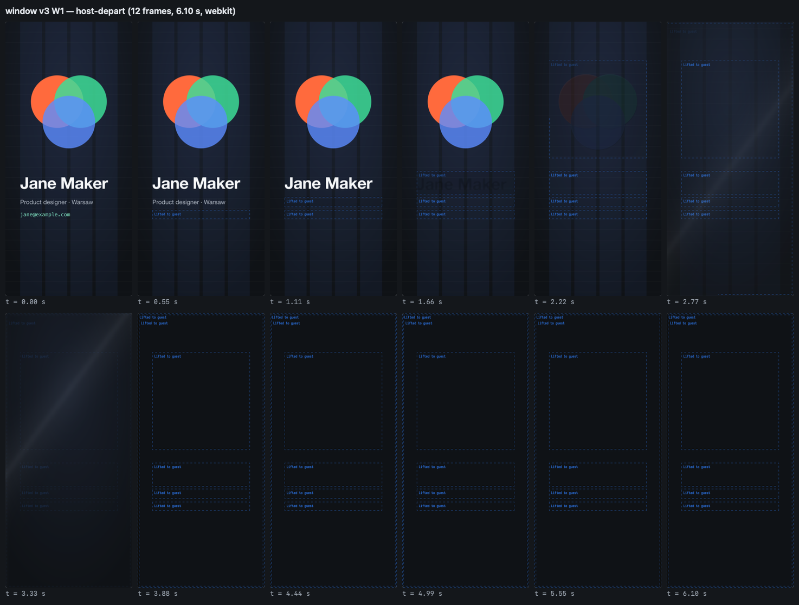
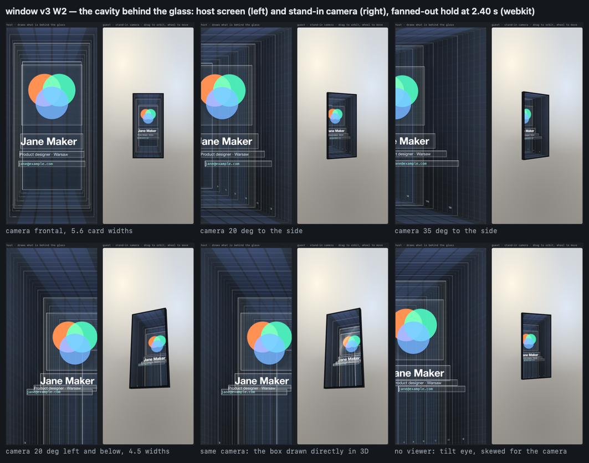
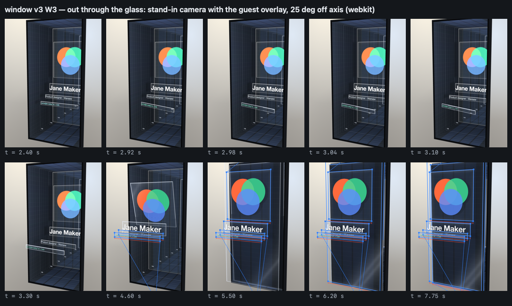
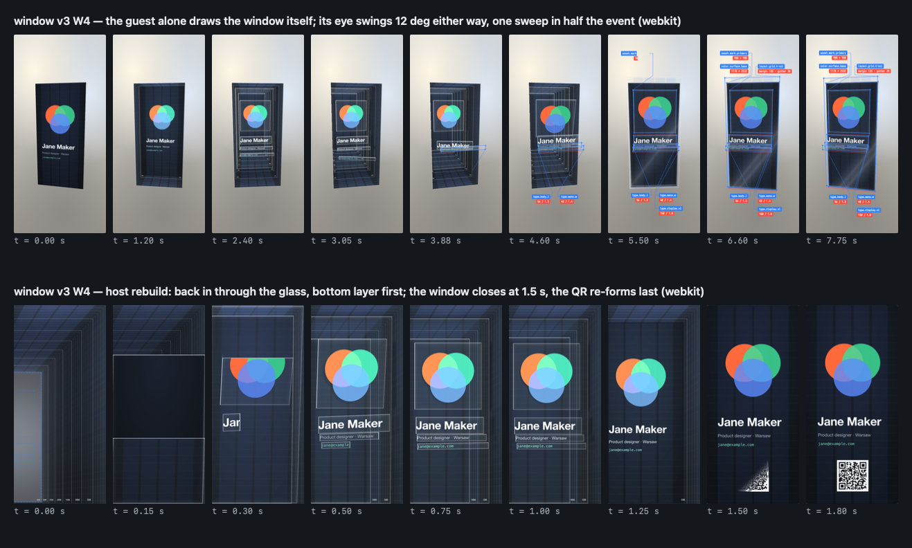
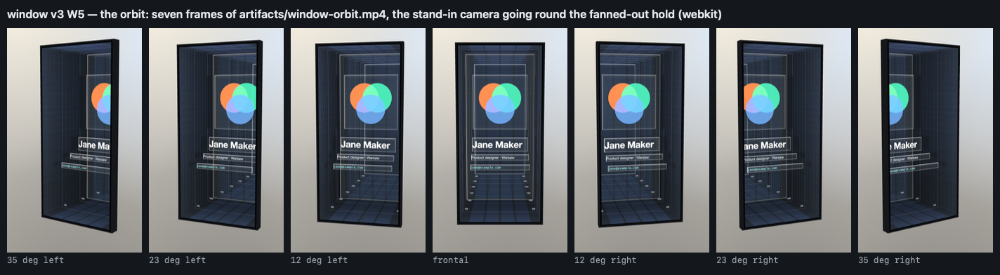

# Process — one image per milestone

Images are contact sheets or stage captures made natively on the Mac (WebKit unless the caption says
otherwise) at the moment the milestone was committed.

## W1 — the skeleton

`w1-skeleton.png` — the starting point: peel v2's effect running under the window name (host
`depart`, 12 frames). Nothing of the window exists yet; the frame shows what the copied code does so
that every later image can be read against it. The copied suite (23 checks) is green in WebKit,
Chromium software GL and Chromium on Metal.

## W2 — the window

`w2-window.png` — the foundation, judged through the stand-in camera at the fanned-out hold
(2.40 s). Left of each pair: what the host screen shows. Right: what a camera at the given place
sees of that screen. The host draws the cavity through a frustum whose apex is the camera, so the
flat picture on the screen reads as a box behind the glass from 0°, 20° and 35°. Bottom row: an
oblique camera; the same camera with the box drawn directly in 3D over the screen (the reference
of `window-truth`: the two agree to 0.39 px); and the host without a viewer, drawing for its tilt
eye instead — from the camera's place the room is then skewed, which is what a viewer prevents.

## W3 — the event

`w3-through-the-glass.png` — ten moments of host `depart` = guest `explode` through the stand-in
camera, 25° off axis, with the guest's picture over it. 2.40 s: the layers hang fanned out inside
the cavity, drawn by the host's screen. 2.92–3.10 s: the top layer crosses the glass in a quarter
of a second; it is tipped, so the glass cuts it along a line that sweeps across it — the part
still behind is on the host's screen (dim, minified by the camera), the part already out is the
guest's (bright, with its acrylic edge), and the two meet within a pixel. 3.30 s: it has landed in
its place in the stack and the next one leans in. 4.60 s: the mark is crossing while three sheets
already carry their chrome. 5.50 s: the background sheet, the last one, sweeps out. 7.75 s: the
full stack with chrome in front of the glass.

## W4 — alone, and back

`w4-alone-and-back.png` — top: the guest with no pose. It draws the window itself, a card-sized
opening with the cavity behind it, from an eye that swings 12° either way; the layers come out on
the same schedule. (Remade at W5: at W4 the swing took 4 s a sweep and went on through the hold
after the event; now a sweep takes half the event and the eye is at rest when the event ends —
3.88 s is the far end of the swing, 7.75 s the end.) Stack and chrome stay inside the 8 % margins
at every angle. Bottom: host
`rebuild` with no viewer, the eye coming from a tilted phone. The layers come back in through the
glass, bottom layer first and bottom edge first, slide into the room, gather, and the window
closes at 1.5 s; the QR re-forms last and the final frame is idle frame zero.

## W5 — the orbit

`w5-orbit.png` — seven frames of `artifacts/window-orbit.mp4`: the stand-in camera goes round the
phone from 35° left to 35° right while the layers hang fanned out inside (2.40 s into the event).
The picture on the screen is flat; it is redrawn for the camera's place in every frame, and from
there it is a box: the walls sweep, the near layers slide against the far background sheet, and
the edge of the phone cuts them off like a window frame. This is the proof the brief asked for,
as far as a stand-in camera can give it.
